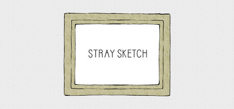

**Stray is the acclaimed adventure game where you play as a stray cat navigating a neon-lit cyberpunk city inhabited by robots after humanity has vanished. Features exploration, puzzle-solving, and a touching relationship between the cat and a companion drone named B-12.**

---

## 📖 About

Stray is the acclaimed adventure game where you play as a stray cat navigating a neon-lit cyberpunk city inhabited by robots after humanity has vanished. Features exploration, puzzle-solving, and a touching relationship between the cat and a companion drone named B-12.

## ⚠️ Problems Without Trainer

| Problem | Status |
|---------|--------|
| **Zurks Chase Sections** — Early game Zurk swarm sequences have punishing timing requirements | ✅ Solved |
| **Memory Collection** — Finding all B-12 memories requires thorough exploration of every area | ✅ Solved |
| **Badge Collection** — Collecting all achievements needs multiple playthroughs or very careful first runs | ✅ Solved |
| **Environmental Puzzles** — Some gate/door puzzles require finding very specific interactive items | ✅ Solved |

## ✅ Solution

The **Stray Trainer** solves all these issues by giving you complete control over the game.

## 🎯 Full Feature List

- Unlimited Resources
- God Mode / Invincibility
- Instant Skill Cooldown
- One-Hit Kill
- Freeze Game Timer
- Unlock All Items & Achievements
- Custom Speed Multiplier
- Save State Anywhere

## 🚀 Quick Start

1. **Disable Windows Defender** temporarily (trainer may trigger false positive)
2. Download the trainer from the button above
3. Launch Stray
4. Run the trainer as Administrator
5. Activate desired cheats with hotkeys

## 💎 Free vs Paid

| Feature | Free | Pro |
|---------|------|-----|
| Basic God Mode | ✅ | ✅ |
| Unlimited Resources | ✅ | ✅ |
| All Advanced Cheats | ❌ | ✅ |
| Auto-Updates | ❌ | ✅ |
| Priority Support | ❌ | ✅ |

## 💻 Requirements

- Windows 10/11 (64-bit)
- Stray (any version)
- .NET Framework 4.8+
- DirectX 11+

## 🍎 macOS

macOS users can use our alternative tool:

## ⚖️ Legal

This trainer is for educational and single-player use only. Use responsibly.

---

